<div align="center">

<a href="https://dourous-nett.vercel.app">
  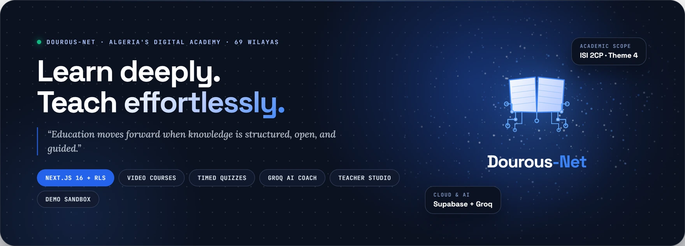
</a>

<br><br>

# Dourous-Net

### *Structured courses. Built for mastery — across all 69 Algerian wilayas.*

[](https://dourous-nett.vercel.app)
[](https://github.com/islemredouane/Dourous-Net)
[](https://nextjs.org)
[](https://react.dev)
[](https://supabase.com)
[](https://groq.com)
[](https://threejs.org)

<br>

**ISI 2CP 2026 — Module Systèmes d'Information · Thème 4 : Éducation · Année 2025–2026**<br>
Full-stack Algerian digital academy uniting video curricula, instant-graded quizzes, private PDF coursework drops, an Educator Studio, and a course-scoped AI Coach — built on Next.js 16, Supabase, Groq Cloud, and Vercel.

<br>

[**Explore Live App**](https://dourous-nett.vercel.app) &nbsp;✦&nbsp;
[**Screenshots**](#-screenshots--ui-tour) &nbsp;✦&nbsp;
[**Try Demo**](#-try-the-interactive-demo) &nbsp;✦&nbsp;
[**Features**](#-features) &nbsp;✦&nbsp;
[**Architecture**](#-architecture) &nbsp;✦&nbsp;
[**Mission 4 Report**](#-mission-4--architectural-report) &nbsp;✦&nbsp;
[**Database**](#-database--storage) &nbsp;✦&nbsp;
[**Deploy & Setup**](#-vercel-deployment) &nbsp;✦&nbsp;
[**Team**](#-team--academic-context)

</div>

<br>

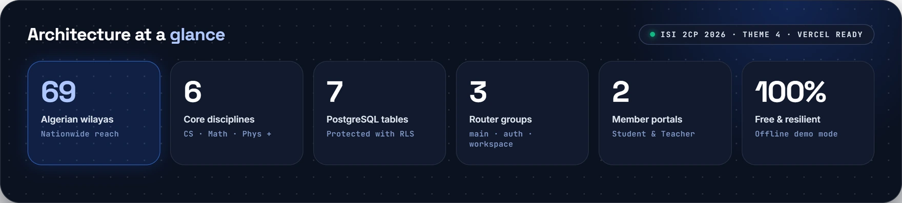

<br><br>

---

## ✦ Overview

**Dourous-Net** organizes university and self-paced education for Algerian students and instructors across **69 wilayas** into one cohesive workspace. Instead of scattering recordings across messaging channels and isolated shared links, every course follows an integrated cloud workflow: **discover by discipline → enroll in one click → stream modular video lessons with an AI Learning Coach → take timed MCQs with instant breakdowns → submit private PDF coursework**.

| Portal | Adaptive Landing (`/`) | Primary Routes |
|---|---|---|
| **Guest / Visitor** | 3D interactive hero (`Three.js`), 6 core disciplines grid, catalog search hub, platform stats, tabbed course preview, compact Campus Voices feedback, FAQ accordion | `/`, `/sessions`, `/sessions/[id]`, `/teachers`, `/teachers/[id]`, `/about` |
| **Student** | **Student Member Home** with welcome pulse, resume-last-lesson links, completion telemetry, and tailored recommendations | `/`, `/dashboard`, `/sessions/[id]/learn/[lessonId]`, `/sessions/[id]/quiz/[assignmentId]`, `/profile` |
| **Educator** | **Teacher Member Home** with active cohort metrics, quick session creation, and direct studio navigation | `/`, `/teacher`, `/teacher/new`, `/teacher/sessions/[id]/lessons`, `/teacher/sessions/[id]/quiz`, `/profile` |

<br>

<div align="center">
  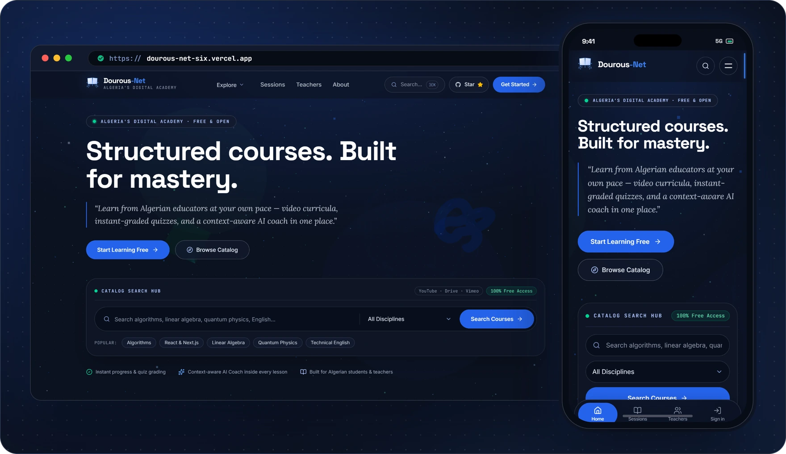
</div>

<br>

---

## ✦ Screenshots & UI Tour

### Desktop Experience

<table>
  <tr>
    <td width="50%" align="center">
      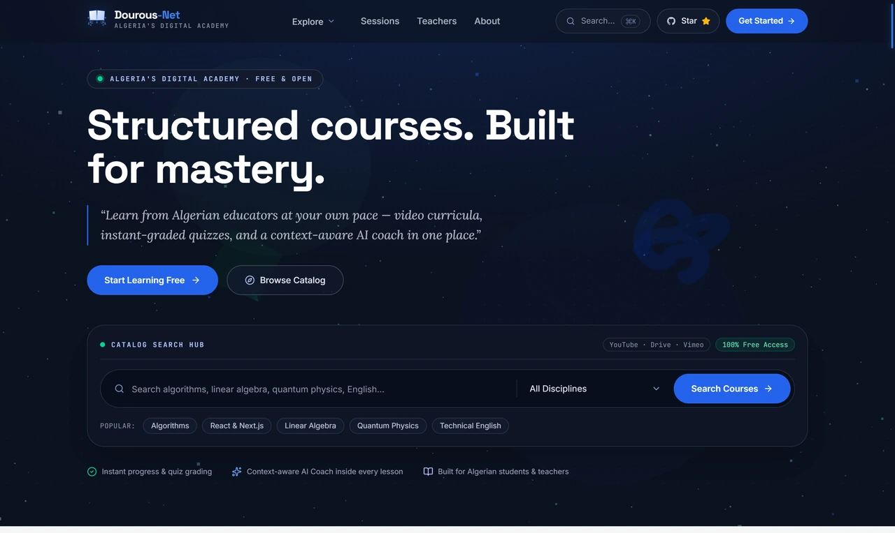
      <br><sub><b>Hero & Catalog Search Hub</b> — 3D canvas, sequential reveal typography, instant search & Explore mega-menu</sub>
    </td>
    <td width="50%" align="center">
      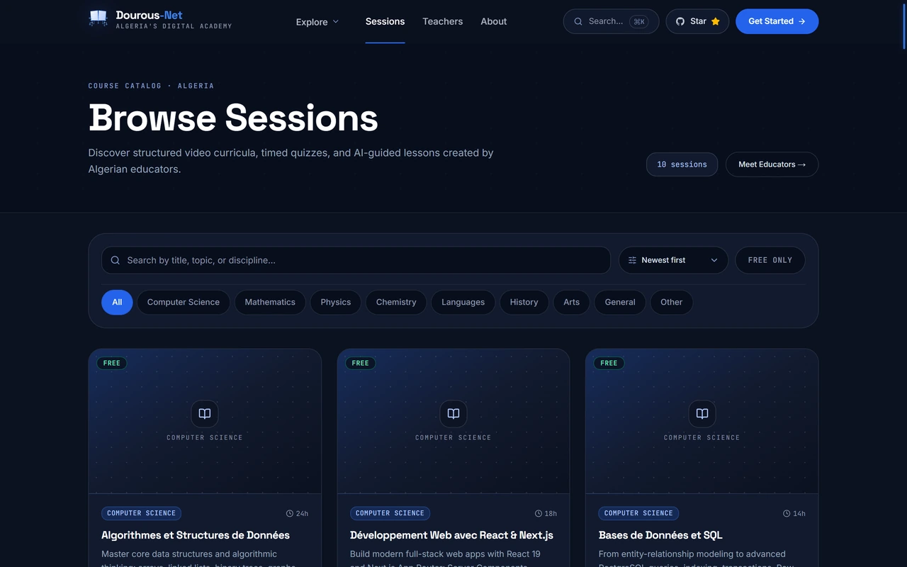
      <br><sub><b>Course Catalog (<code>/sessions</code>)</b> — Discipline filter pills, sort order, free toggle & instant search</sub>
    </td>
  </tr>
  <tr>
    <td width="50%" align="center">
      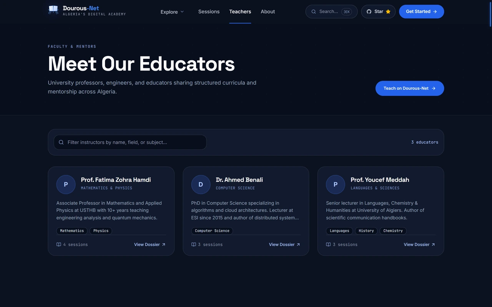
      <br><sub><b>Educators Directory (<code>/teachers</code>)</b> — Public faculty profiles, discipline specialties & session counts</sub>
    </td>
    <td width="50%" align="center">
      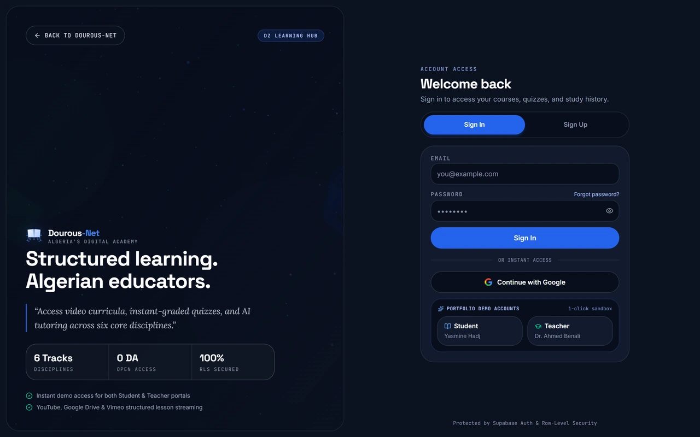
      <br><sub><b>Auth & Demo Sandbox (<code>/auth</code>)</b> — Email/Password, Google OAuth & 1-click Student / Teacher sandboxes</sub>
    </td>
  </tr>
</table>

### Mobile Experience (`390×844` · Floating Bottom Navigation)

<div align="center">
  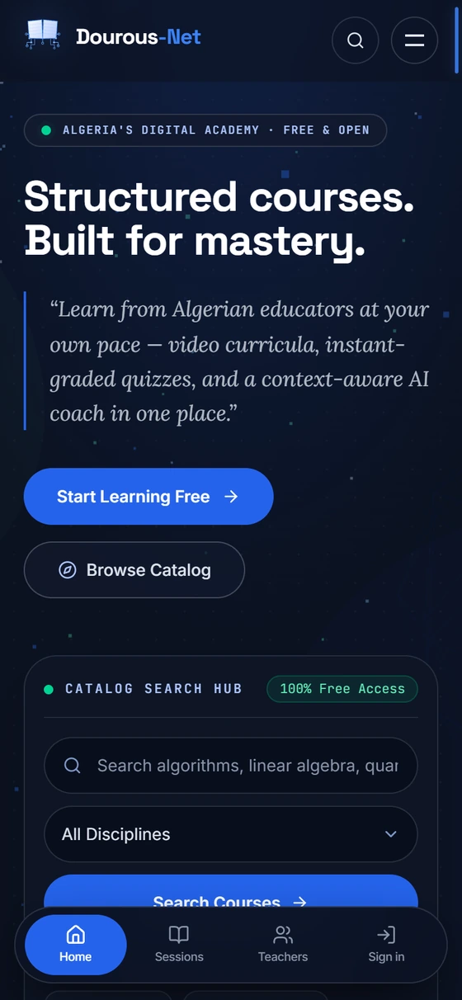
  &nbsp;
  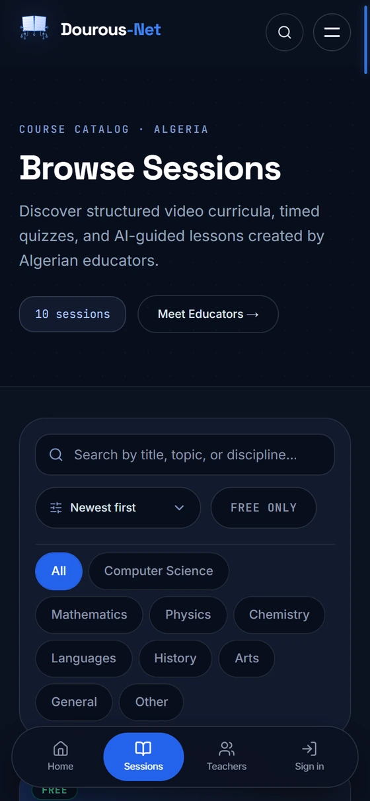
  &nbsp;
  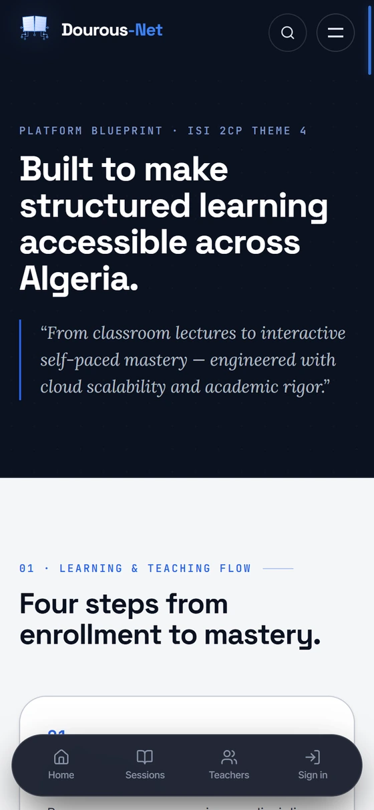
  &nbsp;
  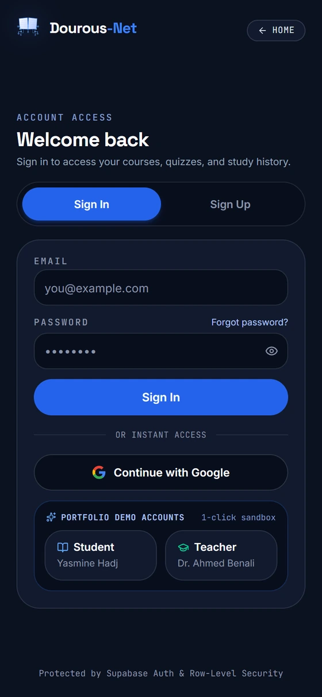
</div>

---

## ✦ Try the Interactive Demo

Dourous-Net ships with a built-in **Portfolio Demo Engine** (`src/lib/demo/`) paired with a **600 ms Supabase reachability circuit breaker** (`src/lib/supabase/reachability.ts`), allowing reviewers, juries, and recruiters to test both **Student** and **Teacher** workflows immediately — even without provisioning a live backend.

1. Visit **[dourous-nett.vercel.app/auth](https://dourous-nett.vercel.app/auth)** (or `http://localhost:3000/auth` locally).
2. Click either **Student · Yasmine Hadj** or **Teacher · Dr. Ahmed Benali** under **Portfolio Demo Accounts** for instant zero-signup cookie session switching.
3. Explore student workflows (course enrollment, video progress tracking, timed MCQ quiz grading, PDF homework upload, AI Learning Coach) or switch seamlessly to **Teacher Studio** (`/teacher`) to publish courses, sequence lessons, build quizzes, and review submissions.

> [!NOTE]
> When connected to a seeded development Supabase instance, sample accounts can also be exercised via email/password on `/auth` (the `/api/seed` endpoint is strictly disabled with HTTP `403` in production).

---

## ✦ Features

<table>
<tr>
<td width="50%" valign="top">

### 🎓 Learner Experience

- **Role-Adaptive Landing:** Signed-in students land on **Student Member Home** with active course resumption, quiz scores, and curated tracks.
  <br><sub>Routes: `/` · `/dashboard`</sub>

- **Explore Mega-Menu & Command Palette (`⌘K`):** Hover-intent discipline drawer and keyboard-first global switcher for courses, faculty, and pages.
  <br><sub>Routes: `/sessions` · `ExploreMegaMenu` · `CommandPalette`</sub>

- **Distraction-Free Video Workspace:** Responsive player supporting YouTube, Vimeo, and Google Drive lessons with automatic chapter progression sync.
  <br><sub>Routes: `/sessions/[id]/learn` · `/sessions/[id]/learn/[lessonId]`</sub>

- **Scoped Groq AI Coach:** Context-aware tutoring seeded with the active session's title, category, syllabus summary, and turn history, with built-in structured offline fallback.
  <br><sub>API: `POST /api/ai-coach`</sub>

- **Timed Quizzes & Coursework Drops:** Countdown MCQ assessments with instant rationale explanations plus private RLS-secured PDF uploads.
  <br><sub>Routes: `/sessions/[id]/quiz/[assignmentId]` · `/dashboard`</sub>

</td>
<td width="50%" valign="top">

### 🧑‍🏫 Educator Studio & Platform Core

- **Teacher Member Home & Studio:** Portfolio analytics (`totalLearners`, `publishedSessions`, `submissionsCount`) and one-click studio actions.
  <br><sub>Routes: `/` · `/teacher`</sub>

- **Session Publisher & Cover Upload:** Create sessions across 6 flagship disciplines (+ general tracks) with thumbnail uploads stored in Supabase Storage.
  <br><sub>Routes: `/teacher/new`</sub>

- **Curriculum Sequencer & Quiz Builder:** Order video lessons by duration/index and construct multi-question timed MCQs with instant grading keys.
  <br><sub>Routes: `/teacher/sessions/[id]/lessons` · `/teacher/sessions/[id]/quiz`</sub>

- **Educator Dossiers & Reviews Table:** Public instructor roster (`/teachers`, `/teachers/[id]`) plus student submission review queues with direct PDF preview.
  <br><sub>Routes: `/teachers` · `/teachers/[id]` · `/teacher`</sub>

- **Installable PWA & Custom UI Chrome:** Native Web App Manifest (`/manifest.webmanifest`), Service Worker (`/sw.js`) with branded offline fallback (`/offline`), maskable & Apple touch icons, iOS/Android install prompts, floating `-Net` blue scrollbar indicator, and mobile bottom capsule nav.
  <br><sub>Routes: `/auth` · `/onboarding` · `/profile`</sub>

</td>
</tr>
</table>

<br>

---

## ✦ Architecture

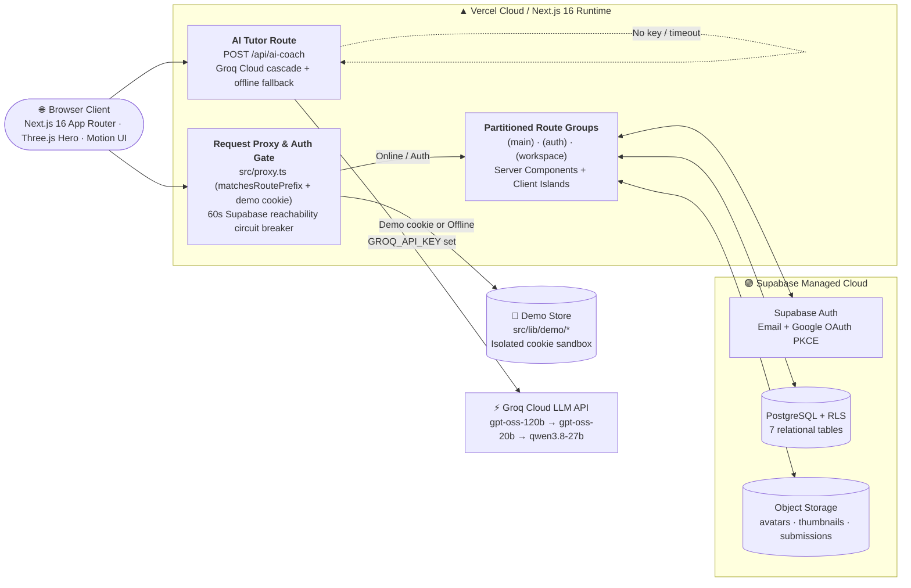

| Architectural Layer | Implementation Details |
|---|---|
| **Route Group Isolation** | Split cleanly into `(main)` (adaptive navbar/footer shell), `(auth)` (focused auth & onboarding canvas), and `(workspace)` (distraction-free player & timed assessment shell). |
| **Boundary-Safe Proxy (`src/proxy.ts`)** | `matchesRoutePrefix()` enforces authentication on `/dashboard`, `/teacher`, `/profile`, `/onboarding` and teacher-only authorization on `/teacher/*` without falsely intercepting public `/teachers/*`. |
| **Zero-Fail Offline Resilience** | `reachability.ts` caches network health for 60s so unreachable local environments fail over to `src/lib/demo/*` instead of hanging SSR requests. |
| **AI Coach Waterfall** | `POST /api/ai-coach` strips `<think>` tags cleanly and cascades `openai/gpt-oss-120b` → `openai/gpt-oss-20b` → `qwen/qwen3.8-27b`, falling back gracefully to structured topic guidance offline. |

<br>

---

## ✦ Mission 4 — Architectural Report

> **Module Context:** *ISI 2CP 2026 — Systèmes d'Information · Thème 4 : Éducation (Architecture Cloud)*

### 1. Entity Mapping (Thème 4)

| Required Role | Supabase Resource | Responsibility in Dourous-Net |
|---|---|---|
| **Table A — Utilisateurs** | `public.students` | Unified profile table for **learners and teachers** (`role`: `student` \| `teacher`), automatically hydrated on signup via `auth.users` trigger (`004_auth_trigger.sql`). |
| **Table B — Ressources** | `public.sessions` | Course catalog published by educators (`teacher_id → students.id`), linked to child curriculum `lessons` and `assignments`. |
| **Table C — Interactions** | `public.enrollments` | Many-to-many learner enrollment with `UNIQUE(student_id, session_id)` constraint, completion progress (`0–100%`), and `submission_url`. |
| **Fichiers (Storage)** | `submissions` (+ `avatars`, `thumbnails`) | Variable-size binary PDF homework drops (private bucket under strict user RLS) alongside public course covers and profile avatars. |

**End-to-End Integrity Flow:**
`Sign Up / Sign In` → `Browse Sessions (Table B)` → `One-Click Enroll (Insert Table C)` → `Watch Lessons (lesson_progress)` → `Complete Timed Quiz (assignment_submissions)` → `Upload Homework PDF (Storage RLS)` → `Teacher Studio Review`

### 2. CAPEX → OPEX Cloud Economics

- **On-Premise Model (CAPEX):** Self-hosting on bare-metal campus servers requires upfront capital procurement (servers ~200,000–500,000 DZD, networking, UPS backup, cooling, and permanent sysadmin maintenance — over 1,000,000 DZD/year total cost regardless of idle traffic).
- **Serverless Cloud Model (OPEX — Vercel + Supabase):** Converts fixed hardware investment into elastic operational expenditure aligned with active usage:

| Cloud Provider | Free Tier (Academic / Launch) | Growth / Production Tier | Role in Dourous-Net |
|---|---|---|---|
| **Supabase** | 500 MB PostgreSQL · 1 GB Storage · 50k MAU | Pro: `$25/mo` (8 GB DB · 100 GB Storage) | Auth, PostgreSQL + RLS, Object Storage |
| **Vercel** | Unlimited Git previews · Global Edge CDN | Pro: `$20/mo` | Next.js 16 SSR, App Router & Serverless APIs |
| **Total** | **0 DZD** *(Zero upfront CAPEX)* | Elastic scaling at peak load | Scales elastically during exam periods |

### 3. Scalability: Physical Data Center vs. Vercel Serverless

| Dimension | Single On-Premise Data Center | Vercel Serverless + Global Edge |
|---|---|---|
| **Latency from Algeria** | `200–400 ms` (single origin bottleneck) | **`< 50 ms`** (Frankfurt / Marseille edge proximity) |
| **Traffic Spikes (Exam Week)** | Weeks (hardware ordering & provisioning) | **Milliseconds** (automatic serverless concurrency) |
| **Low-Traffic Cost** | High fixed power/maintenance overhead | **Scale to zero** (idle cost stays minimal) |
| **Deployment Pipeline** | Manual SSH / container restarts | **Zero-downtime CI/CD** on Git push |
| **Availability & Ops Team** | Dedicated sysadmin + hardware redundancy | **99.99% SLA** managed by a 3-student engineering team |

### 4. Structured vs. Unstructured Storage Strategy

| Paradigm | Backing Store | Stored Data | Engineering Justification |
|---|---|---|---|
| **Structured Relational** | **PostgreSQL (Supabase)** | `students`, `sessions`, `enrollments`, `lessons`, `lesson_progress`, `assignments`, `assignment_submissions` | Foreign-key integrity (`teacher_id`, `session_id`), transactional grading, composite indexes, `UNIQUE` enrollment guards, and DB-enforced Row-Level Security (`auth.uid()`). |
| **Unstructured Object Storage** | **Supabase Storage** | Course `thumbnails` (10 MB public), `avatars` (5 MB public), student `submissions` PDFs (50 MB private) | Avoids bloating relational rows with binary blobs; delivers public covers via CDN while protecting student homework PDFs with signed paths and Storage RLS. |

<br>

---

## ✦ Tech Stack & Design System

<table>
<tr>
<td width="50%" valign="top">

### Tech Stack

| Layer | Technology | Version |
|---|---|---|
| **Framework** | Next.js (App Router + Turbopack) | `16.2.4` |
| **UI Library** | React / TypeScript | `19.2.4` / `5.x` |
| **Styling & Motion** | Tailwind CSS `v4` · Framer Motion | `v4` / `12.38.0` |
| **UI Primitives** | `@base-ui/react` · `shadcn` | `1.4.1` / `4.5.0` |
| **3D Engine** | Three.js · R3F · Drei | `0.184.0` / `9.6.0` |
| **Forms & Toasts** | React Hook Form · Zod · Sonner | `7.73.1` / `4.3.6` / `2.0.7` |
| **Backend & AI** | `@supabase/ssr` · `@supabase/supabase-js` · `groq-sdk` | `0.10.2` / `2.104.1` / `1.2.0` |

</td>
<td width="50%" valign="top">

### Visual Identity & Tokens

| Token / Hex | Preview | Surface & Role |
|---|---|---|
| `--bg-canvas` (`#0B1120`) |  | Deep Space navy canvas & header/footer |
| `--bg-surface` (`#121A2E`) |  | Architectural cards, studio panels & dialogs |
| `--bg-deep` (`#080E1D`) |  | Embedded search hubs, code pills & deep cards |
| `--brand-primary` (`#2563EB`) |  | Primary CTAs, active nav & `-Net` brand accent |
| `--brand-ice` (`#AEC6FF`) |  | Eyebrow indices, highlights & subtle borders |
| `--bg-editorial` (`#F5F6F8`) |  | High-contrast Editorial Mist bands |

**Typography:** `Space Grotesk` (headings), `Inter` (body & dense controls), `JetBrains Mono` (eyebrows & telemetry), `Lora` (italic editorial quotes).

</td>
</tr>
</table>

<br>

---

## ✦ Database & Storage

Run these SQL scripts sequentially inside **Supabase Dashboard → SQL Editor**:

| Order | Script Path | Purpose |
|---|---|---|
| `1` | [`001_create_tables.sql`](supabase/migrations/001_create_tables.sql) | Core tables `students`, `sessions`, `enrollments`, indexes & `updated_at` trigger |
| `2` | [`002_rls_policies.sql`](supabase/migrations/002_rls_policies.sql) | Row-Level Security policies scoping learner & instructor mutations (`auth.uid()`) |
| `3` | [`003_storage_buckets.sql`](supabase/migrations/003_storage_buckets.sql) | Storage buckets `avatars` (5 MB public), `thumbnails` (10 MB public), `submissions` (50 MB private) + RLS |
| `4` | [`004_auth_trigger.sql`](supabase/migrations/004_auth_trigger.sql) | Auto-provisions `public.students` profile row whenever `auth.users` inserts a user |
| `5` | [`006_add_role_field.sql`](supabase/migrations/006_add_role_field.sql) | Extends profiles with `role` (`student` \| `teacher`), `field` & `onboarded` flags |
| `6` | [`005_seed_data.sql`](supabase/seed/005_seed_data.sql) | Starter Algerian faculty profiles & sample courses *(staging / development only)* |
| `7` | [`007_lessons_assignments.sql`](supabase/migrations/007_lessons_assignments.sql) | Curriculum tables `lessons`, `lesson_progress`, `assignments`, `assignment_submissions` + RLS |

<details>
<summary><b>API Routes & App Navigation Map</b></summary>
<br>

| Method | Endpoint / Route | Behavior |
|---|---|---|
| `POST` | `/api/ai-coach` | Scoped Groq Cloud cascade (`gpt-oss-120b` → `gpt-oss-20b` → `qwen3.8-27b`) with deterministic offline fallback |
| `GET` | `/api/auth/callback` | Exchanges Supabase PKCE OAuth code and routes new accounts to `/onboarding` |
| `POST` | `/api/demo/action` | Toggles isolated `student` / `teacher` Demo Mode cookies & resets demo data |
| `GET` | `/api/demo/sample-submission` | Serves a sample coursework PDF preview inside Teacher Studio demo mode |
| `GET` | `/api/seed` | Development-only starter data helper (returns HTTP `403` in production) |

</details>

<details>
<summary><b>Project Structure</b></summary>
<br>

```text
dourous-net/
├── .github/assets/                      # Pre-rendered README banner, stats, preview & screens/*.webp
├── public/
│   ├── favicon.svg                      # Static brand emblem fallback
│   ├── sw.js                            # Service Worker (static chunk cache + offline fallback)
│   ├── icons/                           # PWA PNG icons (192x192, 512x512, maskable 512x512)
│   └── screenshots/                     # Richer Install UI desktop & mobile WebP screenshots
├── supabase/
│   ├── migrations/                      # Ordered PostgreSQL DDL, RLS, Storage & triggers (001–007)
│   └── seed/                            # Starter seed script (005_seed_data.sql)
├── src/
│   ├── proxy.ts                         # Request auth/role proxy (matchesRoutePrefix + offline breaker)
│   ├── types/                           # Generated Supabase DB types & domain interfaces
│   ├── hooks/                           # useUser, useSessions, useEnrollment, useLessonProgress, useUpload, useScrollAnimation
│   ├── lib/
│   │   ├── constants.ts                 # Site metadata, 6 disciplines, filters (69 wilayas)
│   │   ├── discipline-icons.ts          # Shared Lucide icon lookup across navigation menus
│   │   ├── utils.ts                     # Tailwind helpers & multi-provider video URL parsers
│   │   ├── demo/                        # Self-contained Student/Teacher offline sandbox
│   │   └── supabase/                    # SSR server client, browser client & 60s reachability guard
│   ├── app/
│   │   ├── (main)/                      # /, /sessions, /teachers, /about, /dashboard, /teacher, /profile, legal
│   │   ├── (auth)/                      # /auth, /auth/forgot-password, /auth/update-password, /onboarding
│   │   ├── (workspace)/                 # /sessions/[id]/learn/[lessonId], /sessions/[id]/quiz/[assignmentId]
│   │   ├── api/                         # ai-coach, auth/callback, demo/*, seed (dev-guarded)
│   │   ├── offline/page.tsx             # Branded offline fallback route for PWA navigation
│   │   ├── manifest.ts                  # Typed Next.js 16 Web App Manifest + app shortcuts
│   │   ├── apple-icon.png               # 180x180 Apple touch icon auto-linked by App Router
│   │   ├── globals.css                  # Theme tokens, radii, standalone PWA & scrollbar styles
│   │   ├── icon.svg                     # App Router vector favicon
│   │   └── layout.tsx                   # Google Fonts, Viewport, PwaProvider & CommandPalette
│   └── components/
│       ├── 3d/                          # HeroScene, HeroSceneInner, FloatingGeometry, ParticleField, GradientOrb
│       ├── about/                       # AboutCta
│       ├── auth/                        # AuthForm (Email + Google OAuth + Portfolio Demo Mode)
│       ├── dashboard/                   # StatsCards, ContinueLearningCard, EnrolledSessionsList, UploadArea
│       ├── home/                        # StudentMemberHome, TeacherMemberHome, MemberWelcomeBand, MemberPulseCard
│       ├── layout/                      # Navbar, ExploreMegaMenu, FloatingScrollbar, Footer, MobileMenu, BottomNav, CommandPalette, PageWrapper
│       ├── learn/                       # VideoPlayer, LessonView, CourseSidebar, AICoachChat
│       ├── onboarding/                  # OnboardingFlow (first-login role/field/bio setup)
│       ├── profile/                     # ProfileForm (two-column profile & avatar editor)
│       ├── pwa/                         # PwaProvider, InstallAppButton, OfflineActions
│       ├── quiz/                        # Timed QuizTaker & graded QuizResults breakdown
│       ├── sections/                    # HeroSection, FeaturesSection, SubjectsExplorerSection, StatsSection, CoursesPreviewSection, TestimonialsSection, FaqSection, CtaSection
│       ├── sessions/                    # SessionsCatalogClient, SessionCard, SessionFilters, EnrollButton
│       ├── shared/                      # BrandLogo, LogoIcon, CatalogSearchPill, GitHubStarButton, BlurText, SpotlightCard, SectionTitle, LoadingSpinner
│       ├── teacher/                     # TeacherSessionsList, CreateSessionForm, LessonManager, QuizBuilder, SubmissionsList
│       ├── teachers/                    # TeachersDirectoryClient, TeachersHeaderAction
│       └── ui/                          # custom-select, button, input, label, card, badge, avatar, progress, sonner
├── .env.example                         # Safe environment variable template (zero secrets)
├── vercel.json                          # Security & Service Worker cache-control headers
└── .vercelignore                        # Excludes .github/, *.md, supabase/, test artifacts from Vercel deploy
```

</details>

<br>

---

## ✦ Vercel Deployment

> [!CAUTION]
> **Never commit `.env.local` or any real API / database credentials to Git.** `.gitignore` blocks all `.env*` files while keeping `.env.example`, and `.vercelignore` keeps docs and `.github/assets/` out of production serverless bundles. Inject secrets only inside **Vercel Dashboard → Project Settings → Environment Variables**.

1. Import the repository at [vercel.com/new](https://vercel.com/new) with the default **Next.js** preset (`npm run build`).
2. Configure environment variables for **Production** and **Preview**:

| Key | Where to Obtain | Requirement |
|---|---|---|
| `NEXT_PUBLIC_SUPABASE_URL` | Supabase Dashboard → Project Settings → API → **Project URL** | Live PostgreSQL & Auth |
| `NEXT_PUBLIC_SUPABASE_ANON_KEY` | Supabase Dashboard → Project Settings → API → **anon public key** | Live PostgreSQL & Auth |
| `GROQ_API_KEY` | [Groq Console](https://console.groq.com/keys) → Create API Key | Optional *(structured fallback built-in)* |
| `NEXT_PUBLIC_DEMO_MODE` | Set to `true` only for pure backend-free demo deployments | Optional |

3. In **Supabase Dashboard → Authentication → URL Configuration**, set **Site URL** to `https://<your-app>.vercel.app` and add redirect URLs `https://<your-app>.vercel.app/**`, `https://<your-app>.vercel.app/api/auth/callback`, `https://<your-app>.vercel.app/auth/update-password`, and `http://localhost:3000/**`.

> [!TIP]
> For **Google OAuth**, add `https://<your-project-ref>.supabase.co/auth/v1/callback` to Authorized Redirect URIs in Google Cloud Console and enable the Google provider in Supabase Authentication.

<br>

---

## ✦ Local Setup

```bash
# 1. Clone the repository
git clone https://github.com/islemredouane/Dourous-Net.git
cd dourous-net

# 2. Install dependencies
npm install

# 3. Copy the environment template (leave blank or set NEXT_PUBLIC_DEMO_MODE=true for zero-backend Demo Mode)
cp .env.example .env.local

# 4. Run locally
npm run dev
```

| Command | Action |
|---|---|
| `npm run dev` | Start Next.js 16 Turbopack dev server (`http://localhost:3000`) |
| `npm run build` | Compile optimized production bundle |
| `npm run start` | Serve production build locally (`http://localhost:3000`) |
| `npm run lint` | Run ESLint across all source files |

<br>

---

## ✦ Team & Academic Context

Developed for **ISI 2CP 2026 — Module Systèmes d'Information · Thème 4 : Éducation (Année 2025–2026)**.

| Member | Role | Core Focus |
|---|---|---|
| **Redouane Mohamed Islem** | Frontend & UI/UX Architecture | Visual design system, interactive workflows, adaptive Member Home, AI Coach UI, API integration |
| **Boukhanouf Abdelhak** | 3D & Cloud Architecture | Three.js Hero scene, Supabase cloud modeling, Vercel CI/CD & security headers |
| **Zin Mohamed Khalil** | Backend & DevOps | PostgreSQL migrations (`001`–`007`), RLS policies, Auth OAuth callback & route security |

<br>

<div align="center">

[](https://github.com/islemredouane/Dourous-Net)

<br><br>
<sub><b>Dourous-Net</b> · ISI 2CP Theme 4 · Education Cloud Architecture · Algeria · 69 Wilayas</sub>

</div>
